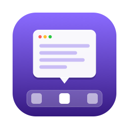

# Peek

Deutsch: [README.de.md](README.de.md)

<p align="center"></p>

Peek is a native macOS menu bar app. It shows window previews when hovering
over Dock icons, and makes Cmd+H hide only the currently focused window
instead of the whole app.

Peek runs without a Dock icon, in the menu bar only, and is not sandboxed.

## Features

- Hover preview panel with thumbnails and titles for a Dock icon's windows,
  including hidden and minimized ones.
- Click a thumbnail to bring that window to the front.
- Hide and close buttons on each thumbnail.
- Cmd+H hides only the focused window, with two hide methods: instant
  "parking" without animation (default), or minimizing as an alternative/
  fallback.
- Windows are restored on Dock icon click, from the menu bar menu, from the
  preview panel, or on app activation when no window of that app is visible.
- A count badge on the Dock icon shows how many windows Peek is currently
  hiding for that app.
- Exclusion list to disable the Cmd+H behavior for specific apps.
- Launch at login.
- Built-in diagnostics report.

## Download

Download `Peek-<version>.zip` from the repository's Releases page, unzip it,
move `Peek.app` to `/Applications`, open it, and grant the permissions Peek
asks for. Release builds are universal (Apple Silicon and Intel) and need
macOS 14 or newer.

Release builds are not signed with a paid Apple Developer ID and are not
notarized, so macOS Gatekeeper blocks the first launch. Allow it under
System Settings → Privacy & Security → "Open Anyway", or remove the
quarantine flag yourself:

```
xattr -dr com.apple.quarantine /Applications/Peek.app
```

Because the app is not signed with a Developer ID, macOS ties the granted
permissions to the exact binary, so Accessibility and Screen Recording have
to be granted again after every update; remove the old Peek entry from each
permission list first, then grant it again.

Building from source instead (see "Build from source" below) and running it
with `./scripts/install.sh` avoids the Gatekeeper prompt, and with a free
"Apple Development" signing identity, permissions survive rebuilds.

## Requirements

The following is only needed to build Peek from source; skip it if you
downloaded a release build above.

- macOS 14 or newer
- Xcode with a Swift 6 toolchain (`swift build`)
- Optionally, an "Apple Development" signing identity in the keychain (a free
  Apple ID in Xcode → Settings → Accounts is enough)

## Build from source

```
./scripts/build.sh
```

Builds `build/Peek.app` in release mode and code-signs it. The script picks
the first "Apple Development" identity from the keychain; a different one can
be set with `PEEK_SIGN_IDENTITY=<SHA-1 or name>`. Without an identity, it
falls back to ad-hoc signing. A stable signing identity matters: with ad-hoc
signatures, macOS drops the granted privacy permissions (Accessibility,
Screen Recording) on every new build, so they have to be re-granted each
time.

```
./scripts/install.sh
```

Builds the app, quits a running instance, replaces `/Applications/Peek.app`
and starts it.

Tests: `swift test`.

To work on Peek in Xcode, run `open Package.swift`. To run the app, use
`./scripts/install.sh` (or launch the built `build/Peek.app`) instead of
running from Xcode directly: permissions, `LSUIElement`, and launch-at-login
all depend on running from the app bundle.

## Permissions

Peek checks three permissions on first launch (menu → "Berechtigungen…"):

- **Accessibility**: required to detect Dock hover, control windows, and
  intercept Cmd+H.
- **Screen Recording**: required to capture window thumbnails. Peek must be
  restarted after granting it, otherwise the grant has no effect. Without
  Screen Recording, the preview panel shows placeholders instead of images.
- **Input Monitoring** (optional): only needed if Cmd+H does not respond even
  though Accessibility is granted.

## Usage

The menu bar menu (German labels in quotes) offers: "Hover-Vorschau" (toggle
the hover preview), "Cmd+H nur für aktuelles Fenster" (toggle the per-window
Cmd+H), "Versteckte Fenster" (apps with windows Peek is currently hiding;
click an entry to restore them), "Hover-Verzögerung" (hover delay),
"Thumbnail-Größe" (thumbnail size), "Einstellungen…" (settings),
"Berechtigungen…" (permissions), "Diagnose ausführen" (run diagnostics),
"Beim Login starten" (launch at login), and "Peek beenden" (quit).

### Cmd+H

Peek intercepts Cmd+H and hides only the focused window of the frontmost app,
instead of hiding the whole app. By default it "parks" the window: moves it
almost entirely off-screen into a free screen corner (a strip 1 pt wide and
about 100 pt tall stays visible) and, on restore, moves it back to its
original position — both without animation.
The "Hide method" setting can switch this to classic minimizing (with the
system animation) instead. After hiding, another visible window of the same app is
raised. If it was the app's last visible window, Peek hides the window and
then also hides the app, like stock Cmd+H. If an app refuses to be moved,
Peek minimizes the window instead.

Cmd+H hides the whole app, as it does without Peek, in these cases:

- the focused window is full-screen,
- the window can neither be moved nor minimized,
- Secure Input is active (e.g. a password field has focus), because the
  event tap does not see key presses while it is.

The exclusion list (bundle IDs) in Settings disables the Cmd+H interception
for specific apps; for those, Cmd+H behaves as it normally does in macOS.

### Dock preview

When the pointer hovers over a running app's Dock icon, Peek shows a
floating panel after a short delay, with thumbnails of all of that app's
windows, positioned above or beside the icon depending on the Dock's
position on screen. Each window is marked with its state: "versteckt"
(hidden — hidden by Peek via Cmd+H), "minimiert" (minimized — minimized the
normal way, not through Peek), or "ausgeblendet" (app-hidden — the app
itself was hidden, e.g. via Cmd+Option+H).

Clicking a thumbnail brings that window to the front. Hovering a thumbnail
reveals two buttons: hide (only for visible windows) and close. The panel
stays open as long as the pointer is over the Dock icon, the panel itself,
or the area between them, and closes about 0.2 s after the pointer has left.
If the pointer crosses a neighbouring Dock icon while moving towards the
panel, Peek does not switch to that app unless the pointer comes to rest on
that icon; moving along the Dock switches the panel immediately.

Peek also draws a small badge with a count over every Dock icon that has
Peek-hidden windows. It briefly disappears while the pointer is over the
Dock, because Dock magnification would otherwise misplace it, and reappears
once the pointer has left. It can be turned off entirely in Settings.

## Settings

| Setting | Default | Description |
| --- | --- | --- |
| Hover-Vorschau aktivieren (hover preview enabled) | on | Enables the Dock hover preview panel. |
| Hover-Verzögerung (hover delay) | 150 ms | Delay before the panel appears; presets are 150/300/500/800 ms. |
| Thumbnail-Größe (thumbnail size) | Mittel (medium) | Thumbnail box size: Klein/Mittel/Groß (small/medium/large). |
| Verstecken per (hide method) | Sofort ausblenden ohne Animation (park) | How Cmd+H hides a window: park (instant, no animation) or minimize (with the system animation). |
| Cmd+H versteckt nur das aktuelle Fenster (single-window hide) | on | Whether Cmd+H is intercepted to hide only the focused window at all. |
| Beim App-Wechsel zuletzt verstecktes Fenster wiederherstellen (restore on activate) | on | Restores the most recently hidden window when the app is activated and none of its windows are visible. |
| Anzahl versteckter Fenster am Dock-Symbol anzeigen (show Dock badges) | on | Shows the count badge over an app's Dock icon. |
| Beim Dock-Klick wiederherstellen (Dock click restore mode) | Nur von Peek versteckte Fenster (Peek-hidden only) | What a Dock icon click restores: only Peek-hidden windows, or all minimized windows of that app. |
| Ausnahmeliste (excluded bundle IDs) | `com.apple.ScreenSharing`, `com.microsoft.rdc.macos`, `com.parallels.desktop.console`, `com.vmware.fusion`, `com.utmapp.UTM` | Apps for which Cmd+H is left untouched. |

## How it works

- Dock hover is detected via an `AXObserver` on the Dock process's `AXList`
  element, listening for `kAXSelectedChildrenChangedNotification`.
- An active `CGEventTap` intercepts keyDown events (to catch Cmd+H) plus a
  listen-only tap for mouse events (to detect Dock icon clicks), both
  running on a dedicated thread with an O(1) callback that only reads a
  lock-protected snapshot and dispatches to the main thread.
- Windows are enumerated through the Accessibility API. Stable window IDs
  come from the private `_AXUIElementGetWindow` symbol, loaded at runtime
  with `dlsym`.
- Thumbnails are captured with ScreenCaptureKit's `SCScreenshotManager`,
  one-shot only (no streaming), and kept in an in-memory LRU cache.
- Parking moves a window so that only a 1 pt wide strip stays on screen.
  macOS does not allow placing a window fully off-screen and clamps a
  window's top to roughly 100 pt above the screen bottom, so a parked
  window is 1 pt wide but still about 100 pt tall on screen.
- The Dock badge is a separate, click-through overlay window, because macOS
  has no API to badge another app's Dock icon.

Source layout (`Sources/PeekKit/`):

**App/**
- `AppDelegate.swift` — `NSApplicationDelegate` entry point; creates and starts `AppCoordinator`.
- `AppCoordinator.swift` — wires all services together and owns their lifecycle.

**AX/**
- `AXElement.swift` — typed wrapper around `AXUIElement` with the attribute accessors Peek needs.
- `AXObserverBox.swift` — wraps an `AXObserver` for one process and delivers its notifications to a closure on the main thread.
- `PrivateAPI.swift` — `dlsym`-loaded `_AXUIElementGetWindow` for stable window IDs.

**Dock/**
- `DockItem.swift` — value type for a Dock icon (title, bundle URL, frame, running state).
- `DockObserver.swift` — observes the Dock's `AXList` selection to detect hover.
- `DockBadgeOverlay.swift` — click-through badge overlay windows, one per app icon.
- `Geometry.swift` — pure coordinate-space and layout math (AX↔Cocoa conversion, panel placement, parking geometry); unit tested without a display.
- `ScreenLayout.swift` — current display layout as AX frames.

**Input/**
- `EventTapThread.swift` — dedicated thread running the key and mouse `CGEventTap`s.
- `HotkeyMatcher.swift` — pure logic deciding whether a keyDown is the Cmd+H to intercept.
- `HotkeyInterceptor.swift` — wires the tap's hide callback to `WindowHider`.
- `DockClickMonitor.swift` — detects a plain click on a Dock icon from the tap's mouse events.
- `DockClickGesture.swift` — pure click-gesture state machine (mouse down/up, modifiers).

**Panel/**
- `PreviewModel.swift` — observable view model for the preview panel.
- `PreviewPanel.swift` — the `NSPanel` hosting the SwiftUI preview view.
- `PreviewPanelController.swift` — drives hover timing, layout, prefetch, and cell actions.
- `PreviewView.swift` — SwiftUI thumbnail grid view.

**UI/**
- `StatusItemController.swift` — menu bar item and its menu.
- `SettingsView.swift` — SwiftUI settings window.
- `PermissionsView.swift` — SwiftUI permissions window.
- `DiagnosticsView.swift` — SwiftUI diagnostics window.
- `WindowPresenter.swift` — opens/reuses AppKit windows hosting SwiftUI content.

**Windows/**
- `WindowManager.swift` — enumerates and manipulates windows through the Accessibility API.
- `WindowInfo.swift` — value types describing a window and its stable key (`WindowKey`).
- `WindowHider.swift` — hides a single window (park or minimize), remembers it, and raises the app's next window.
- `WindowRestorer.swift` — restores hidden/minimized windows in the order that leaves the most recently hidden one frontmost.
- `HiddenWindowStore.swift` — tracks and persists windows Peek has hidden, grouped by app.
- `HiddenWindowTracker.swift` — keeps `HiddenWindowStore` in sync when a tracked window closes, is restored outside Peek, or its app quits.
- `ThumbnailCache.swift` — in-memory LRU cache of window thumbnails.
- `WindowCapturer.swift` — captures window thumbnails via ScreenCaptureKit.

## Privacy and security

- Peek contains no network code at all.
- The key event tap only matches Cmd+H; every other key event is passed
  through unchanged.
- The mouse event tap is listen-only and only evaluates left mouse clicks
  that fall inside the Dock's screen area.
- Thumbnails are kept in memory only and are never written to disk.
- Peek persists its settings and the list of windows it has hidden (window
  IDs, so they can be re-adopted after a restart) in `UserDefaults`.
- "Diagnose ausführen" writes a report to `~/Library/Logs/Peek/`. The report
  contains app names, window titles and window frames. Nothing else is
  written to disk.
- Peek uses one private API, `_AXUIElementGetWindow`, to get stable window
  IDs. This makes it unsuitable for the Mac App Store.
- Peek is not sandboxed.

## Limitations

- "Hiding" (default method "park") moves a window almost entirely off
  screen instead of making it invisible — macOS offers no API for that.
  Mission Control still shows parked windows, and Cmd+` can select them. A
  strip 1 pt wide and about 100 pt tall (plus the window's shadow) stays
  visible in a screen corner, because macOS does not allow a window to be
  placed fully off-screen. Full-screen windows cannot
  be parked (fallback: hide the app). Peek restores parked windows
  automatically on quit; after a crash it picks them back up on the next
  launch, and they can also be restored with a Dock click.
- The Dock preview only lists windows on the currently visible Spaces (plus
  minimized ones).
- Minimized windows cannot be captured. Their thumbnails are the ones cached
  while the window was still visible; without a cached image the panel shows
  a placeholder. Parked windows are still captured live.
- On macOS 15 and newer, the system may re-ask for Screen Recording access
  periodically. Without the grant, the preview shows placeholders instead of
  images.
- While Secure Input is active (password fields, Terminal's "Secure Keyboard
  Entry"), Peek cannot see key presses, and Cmd+H behaves as usual.
- The UI is German only at the moment.

## Troubleshooting

- Cmd+H still hides the whole app: check menu → "Berechtigungen…" (Accessibility),
  the "Cmd+H nur für aktuelles Fenster" toggle, and the exclusion list.
- No thumbnails: grant Screen Recording and restart Peek.
- No panel on hover: run menu → "Diagnose ausführen"; the "Dock hover
  notifications" section must show entries while hovering over the icons.
- Permissions lost after a build: the app was ad-hoc signed, see "Build and
  install".

## Development

```
swift build
swift test
```

Project layout: `Sources/Peek/` is the thin executable entry point;
`Sources/PeekKit/` holds all the app logic, organized as described in "How
it works"; `Tests/PeekKitTests/` holds the unit tests (Swift Testing,
`@Test func`).

Conventions: Swift language mode 5 (set in `Package.swift`); code and
comments are written in English; user-facing UI strings are in German.

AX/Dock/ScreenCaptureKit behavior cannot be exercised in unit tests — they
need a real Dock, a real display, and real permissions. Everything that is
pure logic (geometry, ordering, hotkey matching, caching) is unit tested;
the rest is covered by the manual test checklist in `CONTRIBUTING.md`.

## Prior art

DockDoor (https://github.com/ejbills/DockDoor), AltTab
(https://github.com/lwouis/alt-tab-macos), and AeroSpace
(https://github.com/nikitabobko/AeroSpace) use the same underlying OS
mechanisms as Peek — Dock AX observation, window enumeration via
Accessibility, and off-screen window parking. Peek is an independent
implementation and contains no code from these projects.

## License

MIT, see [LICENSE](LICENSE).
